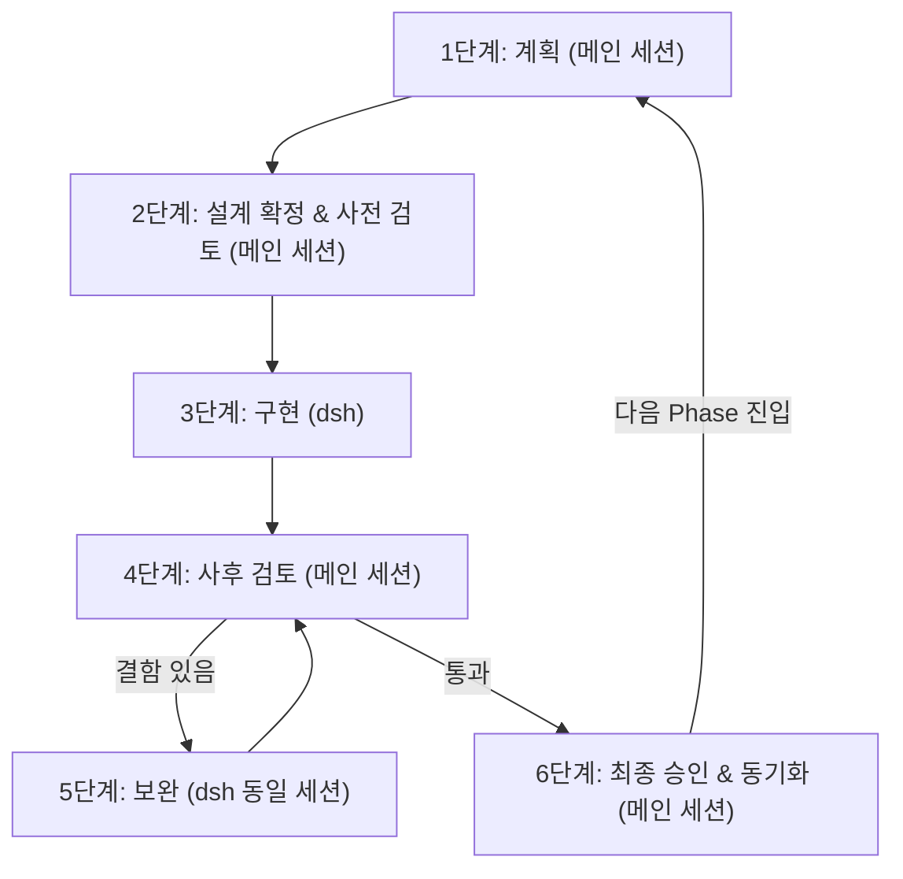

# 📋 Talklite 멀티 에이전트 마일스톤 개발 업무 지침서 (SOP)

> **문서 목적**: Claude Code 메인 세션과 외부 워커(dsh 등)의 역할 분담, 산출물 생성 경로, 표준 6단계 개발 사이클을 규정합니다.
> **적용 환경**: Claude Code 단일 세션(Claude Opus 5.5) + `dsh` 외부 워커 (Windows 로컬 호스트)
> **최초 작성일**: 2026-08-28 (2026-09-03 위키 4대 카테고리 경로 표준화, 2026-09-28 Herdr → Orca 전환, **2026-10-28 Orca 4-Pane 폐지 및 Claude 전역 지침 위임 체계로 전환**)
> **지침서 위치**: `project/Talklite/docs/멀티-에이전트-마일스톤-개발-업무지침서.md` (SSOT)
> **위키 지식 저장소**: `C:\Users\kimmh\VibeCoding\LLM-Wiki\AI-Sessions\wiki\projects\Talklite\`
> **상위 규칙**: 위임 기준·dsh 호출법·검토 방법은 Claude 전역 지침(`C:\Users\kimmh\.claude\CLAUDE.md`)을 따르며, 본 문서는 Talklite 고유 규칙(산출물 경로, 사이클, 품질 게이트)만 정합니다. 두 문서가 충돌하면 전역 지침이 우선합니다.

> [!IMPORTANT]
> **⚠️ 위키 문서 작업 시 필수 준수 규약**:
> 본 프로젝트의 위키(`LLM-Wiki`) 산출물 작업(계획서, 핵심설계, 검토보고서, 완료보고서 작성 및 인덱스/로그 갱신 등)을 진행할 때는 반드시 **[`C:\Users\kimmh\VibeCoding\LLM-Wiki\AGENTS.md`](file:///C:/Users/kimmh/VibeCoding/LLM-Wiki/AGENTS.md)** 문서를 사전에 정독하고 그에 정의된 볼트 운영 규약(카테고리, 네이밍, 한영 하이브리드, 로그 및 인덱스 갱신 등)을 철저히 준수해야 합니다.

---

## 🗂️ 0. 산출물 저장소 및 위키 4대 카테고리 경로 표준

본 프로젝트의 모든 마일스톤 산출물(계획, 설계, 검토, 완료보고서)은 프로젝트 내부 임시 파일이 아닌 **위키(`LLM-Wiki`)의 전용 하위 분류 폴더에 직접 생성 및 영구 보존**됩니다.
프로젝트 루트의 `docs/` 폴더는 상시 참조용 **업무지침서**와 **인수인계서** 단 2개만 단일하게 유지합니다.

```
📁 C:\Users\kimmh\VibeCoding\LLM-Wiki\AI-Sessions\wiki\projects\Talklite\
├── 📄 log.md                                    # 프로젝트 작업 이력 로그
├── 📄 마스터-Talklite.md                        # 프로젝트 마스터 대시보드
│
├── 📁 plans/                                    # [1] 기획 및 마일스톤 실행 계획서
│   ├── Talklite-요구사항-명세서.md
│   ├── Talklite-개발-계획서.md
│   └── Talklite-Phase-X-실행계획.md            # (Step 1: 메인 세션)
│
├── 📁 designs/                                  # [2] 페이즈별 핵심설계 (사전 검토 포함)
│   └── Talklite-Phase-X-핵심설계-해석본.md      # (Step 2: 메인 세션)
│
├── 📁 reviews/                                  # [3] 사후 검토 및 보완 통합 보고서
│   └── Talklite-Phase-X-사후검토.md            # (Step 4 검토 ➔ Step 5 보완 내역 덧붙임)
│
└── 📁 reports/                                  # [4] 마일스톤 최종 완료 보고서
    └── Talklite-Phase-X-완료보고서.md          # (Step 6: 메인 세션)
```

> 기존 Phase의 `reviews/Talklite-Phase-X-사전검토.md`는 기록으로 보존합니다. 신규 Phase부터는 사전 검토 내용을 핵심설계 문서의 `## 사전 검토` 섹션에 둡니다.

---

## 👥 1. 역할 정의

| 역할 | 실행 주체 | 담당 |
| :--- | :--- | :--- |
| **메인 세션** | Claude Code (**Claude Opus 5.5**, `claude-opus-5-5`) | 계획·설계·원인 분석, dsh 작업 지시문 작성, 사후 검토, 위키 한국어 문서 작성, 품질 게이트 승인, 인수인계서 갱신, Git 로컬 커밋. 지시문이 작업만큼 길어지는 1~2줄 수정과 실수 비용이 큰 변경(데이터 마이그레이션, 보안 코드, 되돌리기 어려운 변경)은 직접 수행 |
| **`dsh`** | DeepSeek 워커 (`C:\Users\kimmh\.claude\scripts\dsh-task.ps1`) | 완료 기준과 검증 명령을 줄 수 있는 모든 구현: 기능, 리팩토링, 테스트, 다중 파일 수정, 원인이 밝혀진 버그 수정, 빌드/테스트 통과까지의 반복, 재현·로그 수집 |
| **`miniworker`** | Claude Haiku 서브에이전트 | 통째로 읽어야 하는 큰 한국어 원문의 기계적 추출 (코드 수정 금지) |
| **`agyf`** | 이미지 워커 | 스크린샷·이미지 생성/편집/확인 |
| **`worker`** | Claude Sonnet 서브에이전트 | 사용량 절감용이 아님. 독립 작업 병렬 실행, 또는 dsh가 할 수 없고 메인 컨텍스트를 불릴 큰 작업(대형 위키 ingest, 긴 브라우저 작업)에만 사용 |
| **사용자** | 인간 개발자 | 화면·실사용 동작 확인, 원격 푸시·배포 승인 |

> [!CAUTION]
> * **검토는 위임하지 않습니다.** dsh·worker·miniworker의 결과는 메인 세션이 보고서가 아닌 증거(`checks:`/`watchdog:` 출력, `git diff`, 검증 명령 재실행, 실행된 명령 목록)로 직접 검토한 뒤에만 사용자에게 보고하거나 커밋합니다.
> * dsh는 반드시 git 저장소 안에서만, `run_in_background`로, 동시 3개 이하로 실행합니다.
> * 완료 기준을 쓸 수 없다면 아직 판단이 끝나지 않은 것입니다. 메인 세션에서 먼저 결정한 뒤 위임합니다.

---

## 🔄 2. 마일스톤 표준 6단계 개발 사이클 (Standard Lifecycle)



### 📌 Step 1: 계획 (Plan)
* **주관**: 메인 세션
* **수행 내용**:
  1. 사용자와 범위를 확정하고 위키 **`plans/Talklite-Phase-X-실행계획.md`** 작성
  2. 선행 마일스톤과의 의존성 및 백엔드/프론트엔드 변경 영향도 파악 (CodeGraph `codegraph_explore` 우선)
  3. 완료 정의(DoD)와 검증 명령, 사용자가 직접 확인해야 할 항목(화면, 실사용 동작) 목록 확정

### 📌 Step 2: 설계 확정 & 사전 검토 (Design & Pre-Review)
* **주관**: 메인 세션
* **수행 내용**:
  1. 위키 **`designs/Talklite-Phase-X-핵심설계-해석본.md`** 작성: API/스키마/상태 변경, 대상 파일과 심볼
  2. 같은 문서의 `## 사전 검토` 섹션에 아키텍처 결함, 브라우저 API 제약, WebRTC/STOMP 충돌 가능성, 성능 병목, 엣지 케이스와 각각의 대응을 기록
  3. 사용자 결정이 필요한 항목은 구현 전에 확정

### 📌 Step 3: 구현 (Implementation)
* **주관**: `dsh` (지시문은 메인 세션이 작성)
* **수행 내용**:
  1. 메인 세션이 영어 작업 지시문을 작성: 정확한 파일·심볼, 변경 내용, 완료 기준, 검증 명령, 한국어 UI 문자열은 원문 그대로 명시
  2. `& C:\Users\kimmh\.claude\scripts\dsh-task.ps1 -Cwd <repo> -TaskFile <path>`를 백그라운드로 실행 (긴 작업은 `-IdleMinutes`/`-MaxMinutes` 확대)
  3. 독립된 작업은 최대 3개까지 병렬 실행 가능

### 📌 Step 4: 사후 검토 (Post-Implementation Review)
* **주관**: 메인 세션 (위임 금지)
* **수행 내용**:
  1. `checks:`·`watchdog:` 출력 확인 → `git diff` 정독 → 검증 명령 재실행 → 실행 명령 목록과 git에 안 보이는 부작용(설치, 무시 파일, 저장소 밖 파일) 확인
  2. 코드 품질, 잠재 버그, 리소스 해제 누락(Node disconnect, Event listener 해제 등), 에러 핸들링, 접근성(a11y) 점검. 필요하면 `/code-review` 활용
  3. 결함(P0/P1/P2)과 파일·라인·개선 방향을 위키 **`reviews/Talklite-Phase-X-사후검토.md`**에 기록
  4. **⚠️ [누적 기록(Append-Only) 원칙]**: 기존 내용을 덮어쓰지 않고 `## [Round 1] 1차 사후 검토`, `## [Round 2] 2차 검토` 등으로 하단에 누적합니다.

### 📌 Step 5: 보완 (Refinement)
* **주관**: `dsh` 동일 세션 (`-SessionId <id> -Task "<남은 결함>"`)
* **수행 내용**:
  1. 사후검토의 Action Items를 dsh 동일 세션에 지시하고 Step 4로 돌아가 재검토
  2. 첫 실행 이후 보완 2회로도 해결되지 않으면 남은 부분은 메인 세션이 직접 수정
  3. **⚠️ [단일 통합 보고서 규약]**: 별도 보완보고서를 만들지 않고 `reviews/Talklite-Phase-X-사후검토.md` 하단에 `## 🛠️ 보완 조치 및 최종 반영 내역` 섹션으로 조치 내역과 검증 결과를 덧붙입니다(Append-Only).

### 📌 Step 6: 최종 승인 및 동기화 (Final Approval & Handoff)
* **주관**: 메인 세션
* **수행 내용**:
  1. **품질 게이트 검증**:
     * 프론트엔드: `cd frontend; npm run lint && npm run build` (0 error)
     * 백엔드: `cd backend; .\mvnw.cmd test` (전체 회귀 테스트 ALL PASS, Redis·MariaDB 기동 필요 — `docker compose up -d`)
     * 화면·실사용 동작: 사용자에게 확인 요청 (확인 전에는 완료로 보고하지 않음)
  2. **위키 완료 보고서**: **`reports/Talklite-Phase-X-완료보고서.md`** — 목표와 달성 요약, 주요 구현 내용, 품질 검증 결과 표(린트/빌드/테스트/DoD)
  3. **문서 동기화**:
     * `docs/인수인계서.md` 체크리스트 및 상태 갱신
     * 위키 실행 계획서 `status: completed` 🔵 전환, `log.md` 및 `마스터-Talklite.md` 동기화
     * `qmd update; qmd embed` 지식 인덱싱 (CodeGraph는 파일 감시로 자동 갱신)
  4. **버전 관리**: Git 로컬 커밋. ⚠️ **원격 푸시(`git push`)와 프로덕션 배포는 사용자의 명시적 승인 후에만 수행**
  5. 사용자에게 한국어로 결과 보고 후 다음 Phase의 Step 1로 진입

---

## ⚡ 3. 경량 경로 (Small Changes)

1~2줄 수정, 오탈자, 문서 정정처럼 계획·설계 문서를 쓰는 비용이 작업보다 큰 변경은 Step 1~2를 생략하고 메인 세션이 직접 수정한 뒤 Step 6의 품질 게이트와 인수인계서 갱신만 수행합니다. 기능 동작이 바뀌는 변경은 경량 경로 대상이 아닙니다.

---

## 💡 4. 사용자 제기 결함/문제점(User Feedback) 처리 규칙

**사용자가 실전 테스트 등으로 직접 발견하여 제기한 문제점**은 다음 규칙을 적용합니다:

1. **기존 기능 범위 내 결함 및 버그 수정**:
   - 메인 세션이 원인을 찾은 뒤 수정은 dsh에 위임(1~2줄이면 직접)하고, 가장 최근 페이즈의 `reviews/Talklite-Phase-X-사후검토.md`에 `## [Round X] 사용자 제기 결함 분석 및 조치`로 **하단에 누적 추가(Append-Only, 덮어쓰기 금지)**합니다.
2. **기능 확장 및 신규 파이프라인 도입인 경우**:
   - 새로운 기능/도메인이 도입되거나 파이프라인이 확장되면 기존 페이즈에 덧붙이지 않고 **별도의 독립 마일스톤(Phase X+1)으로 분리하여 6단계 사이클로 관리**합니다.
